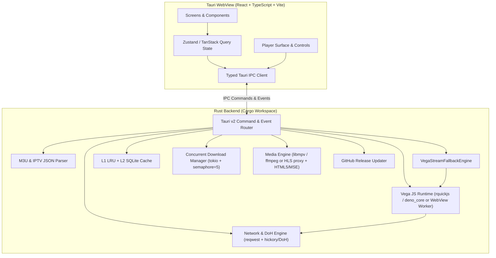

# IPTVMine Desktop — Technical Architecture Document

**Document Status:** Draft v1.0  
**Backend:** Rust (Workspace + Tauri v2)  
**Frontend:** React 18+ / TypeScript / Vite (driven by Cargo / Tauri CLI)  
**Build Philosophy:** Cargo-first orchestration (`cargo tauri dev` / `cargo tauri build`)

---

## 1. High-Level Architecture

IPTVMine Desktop follows a strict **local-first, two-process desktop architecture** powered by Tauri v2:
- **Rust Core (`src-tauri` + modular workspace crates):** Owns all networking, DoH resolution, M3U/JSON parsing, Vega JS runtime execution, caching, SQLite persistence, file downloads, OS integration, and external/embedded media playback control.
- **WebView Frontend (`ui/`):** Thin, reactive React + TypeScript presentation layer communicating strictly over typed Tauri IPC commands (`invoke`) and server-pushed Tauri events (`emit` / `listen`).



---

## 2. Cargo-First Workspace & Project Layout

To honor a **Cargo-first** architecture with clean separation (mirroring `IPTVMine-Pro`'s multi-module Gradle structure `:app`, `:Player`, `:Updater`), the Rust backend is structured as a Cargo workspace under `src-tauri/` (or root `Cargo.toml` workspace):

```text
IPTVMine-Desktop/
├── Cargo.toml                  # Cargo workspace root
├── tauri.conf.json             # Tauri v2 config (beforeDevCommand / beforeBuildCommand)
├── crates/
│   ├── iptvmine-core/          # Domain models (Channel, Provider, Vega*, WatchHistory), ContentFilter, URL utils
│   ├── iptvmine-net/           # Custom DoH resolver, bootstrap DNS, reqwest client, cookie jar, jsDelivr mirror
│   ├── iptvmine-m3u/           # Streaming M3U/M3U8 & IPTV JSON parser + exponential backoff
│   ├── iptvmine-vega/          # Sandboxed JS runtime, TS stripper, cheerio-like DOM bridge, fallback engine
│   ├── iptvmine-storage/       # SQLite (rusqlite/sqlx) + L1 LRU cache + encrypted/atomic settings store
│   ├── iptvmine-downloader/    # Async download queue (max 5), Range resume, progress events
│   └── iptvmine-updater/       # GitHub Releases API client & platform installer check
├── src-tauri/
│   ├── Cargo.toml              # Tauri v2 binary crate wiring all workspace crates
│   ├── capabilities/           # Tauri v2 ACL capability files
│   └── src/
│       ├── main.rs
│       ├── lib.rs
│       ├── commands/           # Typed #[tauri::command] handlers
│       └── state.rs            # AppState (Arc<RwLock<...>>, Tokio runtime handles)
├── ui/                         # Frontend (Vite + React + TypeScript)
│   ├── package.json
│   ├── tsconfig.json
│   ├── vite.config.ts
│   └── src/
└── docs/                       # Planning & architecture documentation
```

### Cargo-First Build Flow
- `cargo test --workspace` runs all unit and integration tests for M3U parsing, DoH resolution, Vega JS bridge, content filtering, cache keys, and download state machines without requiring Node.js.
- `cargo tauri dev` invokes `beforeDevCommand` (`npm --prefix ui run dev`) and attaches the Rust binary.
- `cargo tauri build` invokes `beforeBuildCommand` (`npm --prefix ui run build`), embeds `ui/dist` into the Rust binary, and produces native installers (`.msi`/`.exe`, `.dmg`, `.AppImage`/`.deb`).

---

## 3. Core Subsystems Design

### 3.1 Networking & DNS-over-HTTPS (`iptvmine-net`)
Direct port of `DnsPreferenceManager.kt`:
- **Modes:** `Cloudflare` (`https://1.1.1.1/dns-query`), `Google` (`https://8.8.8.8/resolve`), `AdGuard` (`https://dns.adguard-dns.com/resolve`), `Custom` (user DoH URL), `Off` (system DNS).
- **Bootstrap DNS:** Custom `reqwest::dns::Resolve` trait implementation with hardcoded IPs for `cloudflare-dns.com` / `one.one.one.one` (`104.16.249.249`, `104.16.248.249`, `1.1.1.1`, `1.0.0.1`), `dns.google` (`8.8.8.8`, `8.8.4.4`), and `dns.adguard-dns.com` (`94.140.14.14`, `94.140.15.15`) to prevent circular lookup deadlocks and bypass ISP DNS poisoning.
- **DoH Query:** HTTP GET with `Accept: application/dns-json`, parsing `Answer` records (type `1` A and `28` AAAA), cached in-memory (`DashMap`) with a **5-minute TTL**.
- **Shared Cookie Jar:** Persistent `reqwest_cookie_store` synced with any webview challenge solver (e.g., Cloudflare clearance cookies).

### 3.2 Provider Detection & M3U Engine (`iptvmine-m3u`)
Direct port of `ProviderDetectionEngine.kt` and `ChannelsProvider.kt`:
- **Quick Heuristic (`detect_quick`):** Evaluates URL extension (`.m3u`, `.m3u8`, video extensions), `@` handles, or GitHub/Vega paths instantaneously for live UI feedback.
- **Content Inspection (`detect_from_url`):** Fetches candidate URLs (with `raw.githubusercontent.com` → `cdn.jsdelivr.net/gh/<owner>/<repo>@<branch>` mirror fallback and `/manifest.json` probing) and classifies into `VodScraperMap`, `VodManifest`, `IptvM3u`, `IptvJson`, or `DirectVideo`.
- **Streaming M3U Parser:** Reads response streams incrementally up to `100 MB` max, rejecting binary media `Content-Type`s (`video/*`, `image/*`, `audio/*` while permitting `*mpegurl*` and `application/octet-stream`).
- **Backoff & Cooldown:** 5-minute cooldown for automatic screen-entry refreshes (`load_if_needed`), plus per-URL exponential backoff (`60s * 2^(n-1)`, capped at `3600s`) cleared on explicit user refresh or provider mutation.

### 3.3 Vega JS Extension Engine (`iptvmine-vega`)
Replaces Android's headless `WebView` + `AndroidBridge` with an embedded Rust JS engine (**QuickJS via `rquickjs`**):
- **Why QuickJS (`rquickjs`) in Rust instead of WebView DOM eval:**
  - Deterministic, headless, zero UI-thread blocking, sub-millisecond startup, and **no cross-origin CORS restrictions** on scraper `axios` calls.
  - Proper cancellation: dropping/aborting a `tokio` task or QuickJS interrupt handler immediately cancels in-flight scraping (eliminating Android's leaked 45-second suspended coroutine bug in `BUGS.md`).
- **TypeScript Stripping:** Lightweight pre-processor (e.g., `swc_ecma_parser` / regex stripper matching `VegaProviderRunner`) removes TS type annotations and ESM `export` / `import` syntax so raw Vega `.ts` provider modules run natively.
- **`providerContext` Host Bridge:**
  - `axios` (`.get`, `.post`, `.put`, `.delete`, `.head`, `.patch`, `.request`) backed by `iptvmine-net` (`reqwest` + DoH + `maxRedirects: 0` support for 302 Location extraction like Gofile/HubCloud).
  - `cheerio.load(html)` backed either by a pure-JS lightweight CSS selector wrapper or native Rust `scraper` (`ego-tree` + `selectors`) exposed via QuickJS host functions for 10x faster HTML parsing.
  - `kvStore` (`get`, `set`, `delete`/`remove`, `clear`) scoped **per extension** in SQLite (`extension_kv` table).
  - `getBaseUrl(name)` backed by `ProviderDetectionEngine` discovered endpoint map (`urls.json` / `modflix.json` / `movies.json`).
  - `openWebView(url, options)` optional fallback using an isolated, hidden secondary Tauri window when a site requires full browser JS challenge execution (e.g., Cloudflare Turnstile/JS challenge), returning `{ data, cookies, userAgent, url }`.
- **4-Stage Fallback (`VegaStreamFallbackEngine`):**
  1. Resolve chosen link and sort via `prioritize_streams` (CF Worker > FastCloud > Instant/Google CDN > HubCloud > CF Storage > Gofile > Pixeldrain, then descending quality).
  2. Try sibling `directLinks` on the same server.
  3. Try alternate servers in `meta.link_list` (including lazy `episodes_link` fetch).
  4. Cross-extension search fallback across installed extensions in priority order.

### 3.4 Media Playback Architecture (`Media Engine`)
Desktop browsers/WebViews (WebView2 on Windows, WebKitGTK on Linux, WKWebView on macOS) **cannot natively play MKV, HEVC Main 10, AC3/EAC3, RTMP, or streams requiring custom `Referer`/`User-Agent` headers** in `<video>` tags.
- **Recommended Strategy (Hybrid Embedded + Local Proxy / libmpv):**
  - **Primary Native Player (`libmpv` / `ffmpeg` sidecar or C-API binding):** Renders into a dedicated native child surface or custom frame/IPC control, supporting **all containers & codecs** (HLS, DASH, MKV, 10-bit HEVC, RTMP/RTMPS, embedded ASS/SRT subtitles, multi-audio tracks, hardware acceleration D3D11VA/VideoToolbox/VAAPI) and arbitrary per-stream HTTP headers (`--http-header-fields`).
  - **Fallback / Quick-Start Option:** A local Rust HTTP stream proxy (`127.0.0.1:<ephemeral_port>`) injecting custom headers + `hls.js`/`dash.js` in WebView for HLS/MP4 when `libmpv` is unavailable, plus **"Open in External Player"** (`vlc`, `mpv`) via `tauri-plugin-shell` / `std::process::Command`.
  - *(Note: We will surface the `libmpv` bundling vs external-mpv/HLS.js tradeoff explicitly in Feature Tickets so Milestone 1 works immediately and `libmpv` native embedding lands cleanly.)*

### 3.5 Storage & Two-Tier Caching (`iptvmine-storage`)
Replaces Android `SharedPreferences` + `LruCache` with:
- **SQLite (`rusqlite` with WAL mode)** at `app_data_dir/iptvmine.db`:
  - Tables: `providers`, `installed_extensions`, `watch_history` (capped at 100 entries), `downloads`, `extension_kv`, `cache_entries` (MD5-keyed `posts`, `catalogs`, `scrapers` with `updated_at`), and `settings`.
- **L1 Memory Cache (`lru` / `moka`):** Bounded in-memory caches (`200` post lists, `50` catalogs, `20` manifests) for `< 50ms` tab/category switching.

### 3.6 Concurrent Download Manager (`iptvmine-downloader`)
Direct port of `DownloadManager.kt`:
- `tokio::sync::Semaphore::new(5)` enforcing max 5 concurrent downloads.
- Streams chunks directly to disk (`tokio::io::BufWriter`) with throttled progress events (`download://progress` emitted every 250ms with `downloaded_bytes`, `total_bytes`, `speed_bps`, `progress`).
- Supports HTTP `Range` resume for paused/interrupted downloads and resets `DOWNLOADING` → `PENDING` on startup.

---

## 4. IPC Contract Summary (Rust ↔ React)

| Domain | Commands (`invoke`) | Events (`listen`) |
| :--- | :--- | :--- |
| **Providers** | `list_providers`, `add_provider`, `update_provider`, `remove_provider`, `detect_provider_type`, `inspect_provider_url` | `providers://updated` |
| **Live TV** | `load_channels`, `refresh_channels`, `filter_channels`, `get_categories` | `channels://loading`, `channels://updated`, `channels://error` |
| **Vega / VOD** | `list_extensions`, `set_extension_installed`, `get_catalog`, `get_posts`, `search_posts`, `get_meta`, `get_episodes`, `resolve_stream_with_fallback`, `clear_vod_cache` | `vega://fallback_status` |
| **Player** | `player_open`, `player_command`, `player_get_state`, `launch_external_player` | `player://state`, `player://tracks`, `player://error` |
| **History** | `get_watch_history`, `save_watch_progress`, `get_resume_position`, `delete_history_entry`, `clear_watch_history` | `history://updated` |
| **Downloads** | `enqueue_download`, `list_downloads`, `pause_download`, `resume_download`, `cancel_download`, `delete_download`, `open_download_folder` | `downloads://progress`, `downloads://status` |
| **Network & App** | `get_dns_settings`, `set_dns_settings`, `test_dns`, `get_app_settings`, `set_app_settings`, `check_for_updates`, `get_diagnostics_bundle` | `network://status` |
